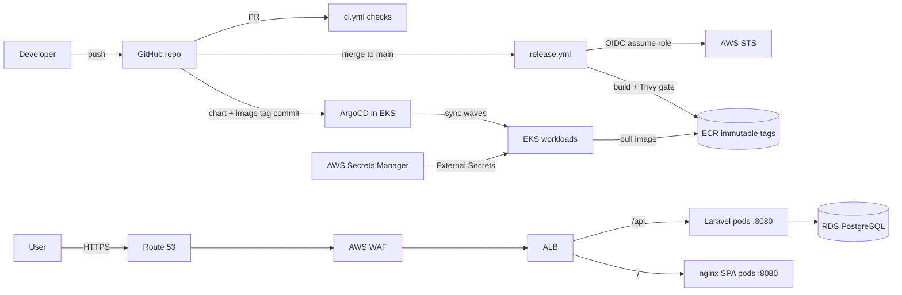

# SecureOps CRM — EKS platform engineering (archived)

A production-shaped DevOps build of a Laravel 12 API and React SPA on AWS:
Terraform-managed VPC/EKS/RDS/ECR, GitHub Actions with OIDC and a
scan-before-push image gate, Helm + ArgoCD GitOps, ALB/ACM/WAF at the edge, and
External Secrets backed by AWS Secrets Manager.

> **Status: archived and torn down on 2026-11-04.** The AWS environment no longer
> exists. This repository is the sanitized DevOps record: infrastructure code,
> delivery pipelines, Kubernetes manifests, runbooks, and the full rebuild
> manual. It deliberately contains **no application source code**.

This is not a tutorial followed once. It is the working configuration, the
failure history, and the teardown record of a stack that was built, broken,
fixed, verified, backed up, restored, slept, woken, and finally deleted.

---

## What this repository demonstrates

| Area | Evidence in this repo |
|---|---|
| Infrastructure as Code | `infra/terraform/` — VPC, subnets, NAT, EKS, managed node group, IRSA, RDS, ECR, WAF, alarms, OIDC |
| Remote state | S3 backend + DynamoDB locking in `infra/terraform/backend.tf` |
| CI | `.github/workflows/ci.yml` — Pint, PHPUnit, ESLint, Vitest, build, Hadolint, Shellcheck, Gitleaks |
| Supply chain | `.github/workflows/release.yml` — build locally → Trivy gate → push immutable `sha-*` tags only if clean |
| Keyless AWS auth | GitHub OIDC trust restricted by repository and ref; no static AWS keys |
| Kubernetes packaging | `charts/secureops/` — Deployments, Services, migration Job, HPA, PDB, Ingress, ExternalSecret |
| GitOps | `argocd/` — AppProject + Application, auto-sync, prune, self-heal, sync waves |
| Edge | ALB Ingress, ACM TLS, Route 53, WAFv2 managed rules + per-IP rate limit |
| Secrets | AWS Secrets Manager → External Secrets Operator → Kubernetes Secret → pods |
| Operations | `ops/sleep.sh`, `ops/wake.sh`, backup/restore drill, teardown and orphan sweep |
| Documentation | 21-chapter rebuild volume, command/file/error/env references, complete sanitized files |

---

## Architecture

Detailed component and failure-domain analysis: [`ARCHITECTURE.md`](ARCHITECTURE.md).

---

## Delivery flow

1. Pull request → CI runs style, unit, frontend, container, and secret checks.
2. Merge to `main` → release workflow requests a short-lived OIDC token.
3. It builds each image locally, scans it with Trivy, and **only pushes if the
   scan passes**. Tags are immutable `sha-<commit>`.
4. The new tag is committed to `charts/secureops/values-staging.yaml`.
5. ArgoCD detects the commit and syncs: ExternalSecret (wave `-10`) → migration
   Job (wave `-5`) → Deployments.
6. The ALB routes `/api/*` to the backend Service and `/` to the frontend.

Why scan-before-push: a manifest scan can warn about an image that is already in
the registry. This pipeline makes the registry the result of the gate, not a
place to discover problems after the fact. The trade-off is no build-time
attestation/SBOM; that is documented rather than hidden.

---

## Security decisions worth discussing

- **No long-lived AWS keys in CI.** OIDC trust is scoped to the repository and
  ref, and the role can only push/pull the two ECR repositories.
- **Immutable image tags.** `sha-*` cannot be overwritten, so a deployed tag
  identifies exact bytes.
- **Non-root containers.** Backend runs as uid 82, frontend as `nginx`, both on
  port 8080 with capabilities dropped.
- **Secrets never in Git.** Secrets Manager + External Secrets; the app Secret is
  rendered into the cluster, not committed.
- **Least-privilege add-on roles.** IRSA roles for EBS CSI, External Secrets, and
  the ALB controller instead of node-wide permissions.
- **Edge controls.** ACM TLS, HTTP→HTTPS redirect, WAF managed rules, and a
  per-IP rate limit.

Honest caveat: the WAF rate rule is global per IP, not scoped to the login path.
A distributed brute force can stay under it. The real fix is an application-level
login limiter or a scoped WAF rule.

---

## Verification performed

- HTTPS SPA and `/api/v1/health` returned 200 after deploy.
- Login succeeded; seeded admin created; a contact persisted across refresh.
- Migration Job completed before pods rolled.
- ExternalSecret reported `SecretSynced`.
- Sleep/wake cycle tested: nodes to zero, RDS stopped, then restored.
- RDS snapshot restored into a disposable instance; row counts matched source
  (`users=2`, `contacts=13`, `logs=13`); test instance deleted.
- Teardown: EKS/RDS/NAT/EIP/EBS/log groups gone; an orphaned ALB, listener, and
  target groups were found and deleted manually.

The restore drill is documented in
[`docs/build-from-zero/17-sleep-wake-backup-restore.md`](docs/build-from-zero/17-sleep-wake-backup-restore.md).
The teardown, including the orphan cleanup, is in
[`docs/build-from-zero/18-teardown-zero-cost.md`](docs/build-from-zero/18-teardown-zero-cost.md).

---

## Known gaps (deliberately stated)

- No metrics-server, so HPA objects exist but CPU autoscaling did not function.
- No Prometheus/Grafana, centralized logs, or tracing.
- CloudWatch alarms existed, but no confirmed SNS subscriber meant no email.
- No WAF rule scoped specifically to `/api/v1/login`.
- No image signing, SBOM, or provenance attestation.
- No production environment was deployed; `prod` files are templates.
- ArgoCD was bootstrapped from upstream `stable`, not a pinned release.
- Terraform used the deprecated `dynamodb_table` locking argument.

A senior engineer names the gap and the next step. See
[`SKILLS_EVIDENCE.md`](SKILLS_EVIDENCE.md) for the mapping and remediation
backlog.

---

## Cost discipline

The stack was built on a tight budget. The expensive insight: an "idle" lab still
bills for the EKS control plane, NAT gateway, ALB, WAF, and RDS storage. Scaling
nodes to zero is not the same as zero cost.

This repo includes:

- `ops/sleep.sh` / `ops/wake.sh` for between-demo power management.
- Budget and anomaly-detection commands in
  [`docs/build-from-zero/19-cost-guardrails.md`](docs/build-from-zero/19-cost-guardrails.md).
- A strict teardown order and orphan sweep in
  [`docs/build-from-zero/18-teardown-zero-cost.md`](docs/build-from-zero/18-teardown-zero-cost.md).

The full financial postmortem is intentionally private. The engineering lessons
are public.

---

## How to review this repo in 10 minutes

1. Read `infra/terraform/network.tf`, `eks.tf`, and `rds.tf` — the core AWS shape.
2. Read `.github/workflows/release.yml` — the scan-before-push gate.
3. Read `charts/secureops/templates/` — workloads, Job, HPA/PDB, Ingress.
4. Read `argocd/apps/staging.yaml` — sync policy, waves, drift handling.
5. Skim `docs/build-from-zero/` — the rebuild narrative and failure modes.
6. Read `INTERVIEW_STORIES.md` — the decisions behind the code.

---

## Documentation map

| Start here | What it covers |
|---|---|
| [`docs/build-from-zero/00-read-me-first.md`](docs/build-from-zero/00-read-me-first.md) | How to use the 21-chapter rebuild volume |
| [`docs/DEVOPS_ENGINEERING_MANUAL.md`](docs/DEVOPS_ENGINEERING_MANUAL.md) | Concept + implementation manual |
| [`docs/reference/command-index.md`](docs/reference/command-index.md) | Every command with a safety label |
| [`docs/reference/errors.md`](docs/reference/errors.md) | Exact error → cause → fix |
| [`docs/reference/environment-variables.md`](docs/reference/environment-variables.md) | Terraform, GitHub, Helm, and process env |
| [`docs/build-from-zero/appendix/full-files.md`](docs/build-from-zero/appendix/full-files.md) | Sanitized verbatim file contents |
| [`docs/PROJECT_JOURNAL.md`](docs/PROJECT_JOURNAL.md) | Dated build, incidents, tests, teardown |

Additional hiring material:

- [`RESUME_BULLETS.md`](RESUME_BULLETS.md)
- [`SKILLS_EVIDENCE.md`](SKILLS_EVIDENCE.md)
- [`INTERVIEW_STORIES.md`](INTERVIEW_STORIES.md)
- [`SANITIZATION.md`](SANITIZATION.md)

---

## What is intentionally excluded

Application source (`backend/app`, `frontend/src`), private Git history, secrets,
state files, account-specific identifiers, and the private financial postmortem.
See [`SANITIZATION.md`](SANITIZATION.md) for the exact rules.

## License

All rights reserved. See [`LICENSE`](LICENSE). The code is published for review
and portfolio purposes; it is not licensed for reuse or redistribution.
