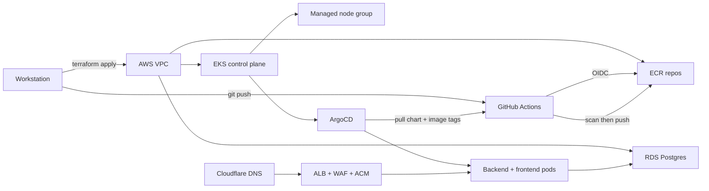

# Volume 0 — Build from Zero

> **Status:** the original AWS environment was decommissioned on 2026-11-04.
> This volume is a reproducible rebuild guide. It preserves the exact command
> sequence, the reasoning behind each step, and the failures that were actually
> encountered. Nothing here is a live-state claim.

## What this volume is

The main manual (`docs/DEVOPS_ENGINEERING_MANUAL.md` and `docs/devops-manual/`)
explains the *system*: architecture, trade-offs, operations, and troubleshooting.
This volume explains the *build*: a chronological path from an empty workstation
to a working deployment, then to a verified zero-cost teardown.

Read it in order the first time. On later rebuilds, use
`20-rebuild-checklist.md` as the fast path and jump back into chapters only
when something differs.

## What you need

- An AWS account you control, with a payment method and MFA on the root user.
- A GitHub account and a repository that will hold this code.
- A domain you control (Cloudflare in this build) **or** the willingness to use
  the raw ALB hostname by leaving `domain_name` empty.
- A Linux/macOS workstation with Git, Docker, and internet access.
- Roughly 2–3 hours for a first attended rebuild.
- Money. Read the cost warning below before creating anything.

## Cost warning — read this before step 1

This stack is not free. At the time of writing, the steady run-rate was roughly
**$199/month awake** and **$100/month asleep** in `ap-south-1`. The expensive
parts are EKS, the NAT gateway, the ALB, RDS, and the worker nodes. Sleeping
(nodes to zero, RDS stopped) removes most but not all of the bill. Deleting the
stack is the only true zero-cost state.

The project's own history includes an unexpected bill caused by leaving nodes
running. Do not repeat it:

1. Create a budget and billing alarm **before** the first billable resource.
2. Never leave the environment running unattended.
3. Run the teardown checklist at the end of every session.
4. Verify zero cost with Cost Explorer, not with hope.

## Safety labels used in commands

| Label | Meaning |
|---|---|
| `READ-ONLY` | Safe to run; only reads state. |
| `STATE-CHANGING` | Creates, updates, starts, or pushes something. |
| `DESTRUCTIVE` | Deletes data or billing resources; irreversible. |

If a command has no label, assume `STATE-CHANGING` and read it before running.

## Placeholders

Replace these before running commands that create cloud resources:

| Placeholder | Example |
|---|---|
| `<ACCOUNT_ID>` | your 12-digit AWS account ID |
| `<GITHUB_OWNER>` | `ShubhamShrestha60` |
| `<GITHUB_REPO>` | your private application repository |
| `<DOMAIN>` | `staging.example.com` |
| `<ACM_CERT_ARN>` | output of the ACM certificate request |
| `<AWS_REGION>` | `ap-south-1` |

Never paste a real password, token, private key, or Terraform state into a file
that Git tracks. This repository's `.gitignore` already excludes `.env`,
`*.tfstate*`, `.terraform/`, and key material.

## The build in one picture

## Chapter map

| Chapter | Outcome |
|---|---|
| `00-read-me-first.md` | Safety, cost, mental model. |
| `01-accounts-budget-domain.md` | AWS/GitHub/domain foundations and budget guardrail. |
| `02-workstation-setup.md` | Every CLI installed and verified. |
| `03-repo-and-local-environment.md` | Local app running before touching AWS. |
| `04-aws-bootstrap-and-remote-state.md` | Remote state and lock table. |
| `05-network-vpc-subnets-nat.md` | Network layer. |
| `06-eks-cluster-nodes-addons.md` | Cluster, nodes, IRSA add-ons. |
| `07-rds-secrets.md` | Database and secret store. |
| `08-ecr-and-github-oidc.md` | Registries and keyless CI auth. |
| `09-docker-images.md` | Reproducible images. |
| `10-ci-pipeline.md` | Pull-request checks. |
| `11-release-pipeline.md` | Build → scan → push gate. |
| `12-helm-chart.md` | Kubernetes desired state. |
| `13-argocd-gitops.md` | Pull-based deployment. |
| `14-alb-ingress-tls-waf.md` | Public HTTPS entry point. |
| `15-first-deploy-and-verification.md` | Prove the whole path works. |
| `16-operate-debug-and-observe.md` | Day-2 operations. |
| `17-sleep-wake-backup-restore.md` | Cost and data recovery drills. |
| `18-teardown-zero-cost.md` | Delete everything and prove it. |
| `19-cost-guardrails.md` | Make the expensive mistake impossible. |
| `20-rebuild-checklist.md` | One-page sequence. |
