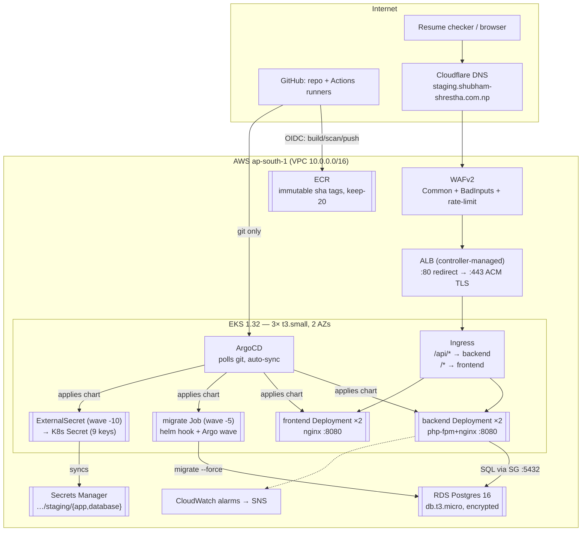

# Part I — Chapter 3: System architecture

> **Status:** The AWS environment was decommissioned on 2026-11-04. Live-state statements in this chapter describe the October 2026 deployment and are preserved as an as-built record.

## 3.1 End-to-end architecture



Trust boundaries (who may talk to whom, enforced where): Internet→WAF→ALB
(SG-less, AWS-managed) → pods (ClusterIP Services, in-cluster only) → RDS
(security group allows :5432 **only from EKS node SG**, `rds.tf:6-25`).
Pods cannot reach the internet except via NAT (private subnets); nodes pull
images via ECR VPC endpoints/public NAT. GitHub reaches AWS only as the
single OIDC role `secureops-staging-github-release` (ECR-push scoped), and
reaches the cluster not at all.

## 3.2 Application request flow (one login, annotated)

1. `POST https://staging…/api/v1/login` → Cloudflare CNAME → ALB:443
   (ACM decrypts; WAF inspects; HTTP:80 301-redirects).
2. Ingress rule `/api` (Prefix) → backend Service `:80` → pod `:8080`.
3. Pod nginx → php-fpm `:9000` → Laravel: throttle `10,1` (`routes/api.php`),
   `LoginRequest` validation (422 on failure), Sanctum token issue.
4. DB credentials arrive as env-from-Secret (populated by ESO from Secrets
   Manager, refreshed `1m`); query goes to RDS through the node SG rule.
5. SPA calls use same-origin `/api/v1` (`VITE_API_BASE_URL`), so browsers
   never see CORS or a second origin. INFERENCE: the `try_files … /index.html`
   fallback is what makes SPA deep-links work behind `/`.

## 3.3 Developer-to-production flow (the golden path)

```
code → push main → CI (Pint/PHPUnit/ESLint/Vitest/Hadolint/Gitleaks, no AWS)
     → Release: meta tag → backend{build local → Trivy gate → docker push}
                                frontend{…same, parallel…}
     → human pins sha-xxx in values-staging.yaml → push
     → ArgoCD sync: ExternalSecret(-10) → migrate Job(-5) → Deployments(0)
     → HPA/PDB/Ingress converge → verify /api/v1/health + / (Ch. 9)
```

Rollback is the same path backwards: revert the tag line, push, ArgoCD
re-deploys the older immutable image. Migrate rollback is the known gap:
`migrate --force` has no down-migration automation — schema rollbacks are
manual SQL, documented in Ch. 10.

## 3.4 Dependencies and ordering (why boot order matters)

Terraform: VPC → EKS (+IRSA roles) → LB Controller/ESO Helm releases
(serialized: ESO `depends_on` LB controller — learned from the webhook race,
Ch. 10) → RDS/ECR/OIDC-role (parallel-safe). GitOps: ClusterSecretStore →
ExternalSecret → Secret → migrate Job → Deployments → Ingress/ALB listeners.
Each arrow was once a real outage in this project's history; Ch. 10 retells
them as runbooks.

## 3.5 Stateful vs stateless (the only distinction that controls DR)

- **Stateless (recreatable from git+ECR in minutes):** Deployments, Services,
  Ingress/ALB config, ArgoCD apps, WAF rules, alarms, nodes.
- **Stateful (loss = incident):** RDS data (backups: daily auto + manual
  drill snapshot, Ch. 11/`backup-restore.md`), Secrets Manager values (no
  versioning configured — rotate carefully), Terraform state in S3 (versioned
  bucket — never delete), ECR images (immutable, keep-20).
- **Ephemeral by design:** migrate Jobs (hook-deleted), ESO-synced K8s
  Secrets (recreated from SM), build attestations.

## 3.6 Single points of failure and limits (stated plainly)

1. One cluster, one region: AZ-resilient, not region-resilient.
2. `db.t3.micro` single-AZ, 1-day backup retention: cost choice, not HA.
3. One NAT gateway (staging `single_nat_gateway=true`): AZ failure degrades
   egress (image pulls stall) until nodes reschedule.
4. Demo seed account is a shared public credential: acceptable for a showcase,
   unacceptable anywhere real (Ch. 7).
5. No metrics pipeline (`kubectl top` fails): capacity calls use requests/limits
   arithmetic — demonstrated in the t3.small sizing episode (Ch. 12).
6. ALB controller / ESO / ArgoCD are cluster-singletons: their outage freezes
   *change*, not traffic — understand this asymmetry before paging anyone.
