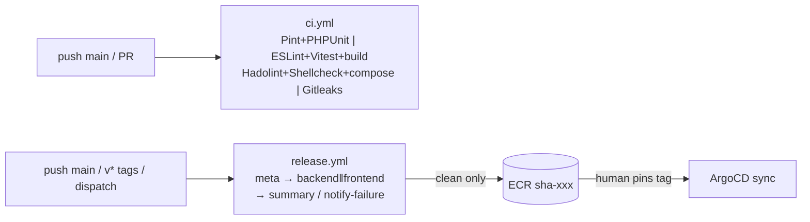

# Part V — CI/CD and automation

> **Status:** The AWS environment was decommissioned on 2026-11-04. Live-state statements in this chapter describe the October 2026 deployment and are preserved as an as-built record.

## 6.1 Pipeline map (what runs when)

`ci.yml` triggers on pushes to `main`/`develop` + PRs to `main`
(`cancel-in-progress`, no AWS). `release.yml` triggers on `main` pushes,
`v*` tags, manual dispatch with optional tag override; concurrency group
per-ref, no cancel (releases never interrupt each other).

## 6.2 CI in detail (`ci.yml`)

Four jobs: backend (`setup-php 8.3` + sqlite/mbstring, `composer install`,
`pint --test`, `artisan test`), frontend (Node 20, `npm ci`, lint, Vitest,
`build`), containers (Hadolint both Dockerfiles, Shellcheck entrypoint,
`compose config`), secrets (Gitleaks full-history). Runner: `ubuntu-latest`,
`contents: read` only. Failure meanings: Pint = style drift (run `pint`
locally via the composer container); PHPUnit = run same command locally
(needs `backend/.env` — copy from example, gitignored); Hadolint = pin apk
versions or extend the existing `ignore` comments deliberately; Gitleaks =
secret committed → rotate it, history rewrite alone is insufficient.

## 6.3 Release in detail (`release.yml`) — read every stage

- **`meta`**: resolves tag (`inputs.tag` > `v*` ref > `sha-<12>`), exposes
  `outputs.value`. Single source of truth; both build jobs consume it.
- **`backend` / `frontend` (parallel, `needs: [meta]`)**: checkout → OIDC
  creds (role from `vars.AWS_ROLE_TO_ASSUME`, region from vars) → ECR login →
  Buildx → **build local** (`push:false, load:true`, final ECR name, GHA
  cache) → **Trivy gate** (`table` for logs, HIGH/CRITICAL, `exit 1` — job
  dies here on CVEs, push step skipped) → **`docker push` of the exact
  scanned image object**. Then a SARIF-format re-scan (`exit 0`, DB cached)
  + `upload-sarif` to the Security tab (needs repo `security-events: write`,
  granted at workflow top).
- **`summary`** (needs all, runs only on full pass): prints tag + next step
  (pin values). **`notify-failure`** (`if: failure()`): `::error::` annotation
  with triage pointers.

Why this shape (each line encodes an incident): `load`+`docker push` (not
build-push `push:true`) because **push-before-scan shipped vulnerable images**
— the gate must own bytes before the registry does (provenance/SBOM
attestations were dropped for the same reason: they require push-first);
QEMU removed (native amd64); Trivy `v0.36.0` pinned because `0.28.0` lacked the
`v` prefix, `0.24.0` never existed, and `v0.28.0`'s nested `setup-trivy@v0.2.1`
was deleted upstream (verify tags via the tags API before future bumps);
`latest` tag removed after the immutability collision; `GetDownloadUrlForLayer`
added to the role after Trivy pulls were denied.

## 6.4 Credentials, runners, cache, variables

- Auth: OIDC only. Workflow needs `id-token: write`; role trust needs
  `aud=sts.amazonaws.com` + numeric-ID `sub` pattern (Ch. 4.6). No static keys
  anywhere; runners are ephemeral `ubuntu-latest`.
- Variables (repo Settings → Variables, **not** Secrets — workflow reads
  `vars.*`): `AWS_REGION`, `AWS_ROLE_TO_ASSUME`, `ECR_*_REPOSITORY`.
  Typo/whitespace here produces STS denials with no CloudTrail trace for the
  role (Ch. 10) — verify by pasting values, not by re-reading code.
- Cache: GHA cache for Buildx layers + Trivy DB (second scan is seconds).
- Promotion: human pins `sha-xxx` in `values-staging.yaml` (deliberately
  manual; Image Updater is the documented next step, Ch. 12). Rollback: revert
  the pin. No approvals framework beyond git history + ArgoCD diff — adequate
  and honest at this scale.

## 6.5 Operating the pipeline (inspect/retry/recover)

- Watch: repo → Actions → run → per-job step logs. Re-run failed jobs (not
  whole workflow) after infra fixes (e.g., post thumbprint/OIDC repair).
- `workflow_dispatch` with `tag` input rebuilds/repushes a known tag without
  a code push (careful: same-tag rebuilds are new bytes under an old name —
  prefer fresh commits).
- Common failures → Ch. 10 entries: OIDC denial, Trivy CVE gate (triage real
  CVEs, never lower severity to ship), ECR immutable collision (never push
  `latest`), build exit 2 at `composer install` (lock/platform drift — run
  `composer update --lock` in a PHP-version-matched container).
- Weaknesses stated plainly: single reviewer bottleneck (tag pinning is one
  human), no staging-slash-prod promotion ladder (single env by decision), no
  deployment freeze windows, SARIF-only-if-push-runs (failed pre-scan jobs
  still upload via `if: always()` — verify this stays true after edits).
